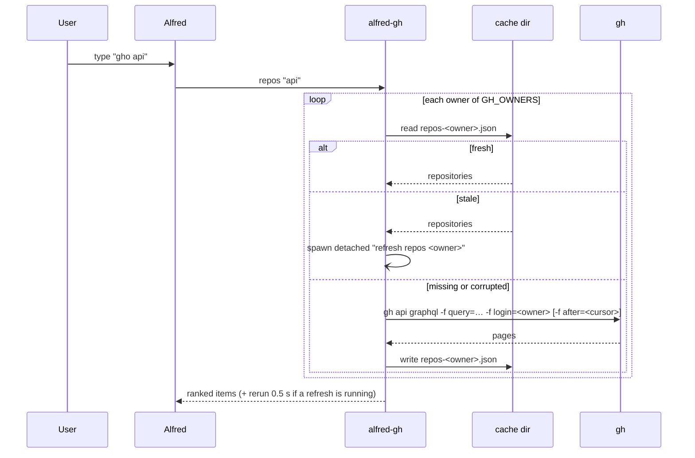

# Architecture

## Overview

The workflow is a single Rust binary, `alfred-gh`, with one subcommand per
object in the Alfred workflow graph:

| Subcommand                  | Alfred object                | Keyword | Responsibility |
| --------------------------- | ---------------------------- | ------- | -------------- |
| `alfred-gh search [query]`  | Script Filter                | `gh`    | Public repository search, live, never cached. |
| `alfred-gh repos [query]`   | Script Filter                | `gho`   | Repositories of `GH_OWNERS`, ranked. |
| `alfred-gh prs [query]`     | Script Filter                | `ghp`   | Pull requests of one repository (resolved from `owner/name` or a bare name). |
| `alfred-gh workflows [query]` | Script Filter              | `gha`   | Actions workflows of one repository with their last run, or one workflow's runs (`runs:<id>`). |
| `alfred-gh review [query]`  | Script Filter                | `ghr`   | Open pull requests across `GH_OWNERS` where my review is requested. |
| `alfred-gh mine [query]`    | Script Filter                | `ghm`   | My open pull requests across `GH_OWNERS`. |
| `alfred-gh run <arg>`       | Run Script (`action.script`) | —       | Decode the selected item's `arg` and perform it. |
| `alfred-gh refresh <key>`   | — (spawned detached)         | —       | Rewrite one stale cache entry. |

Every script filter is connected to the single Run Script, itself connected to
a Post Notification that shows whatever `run` prints (copies, clones, errors).

## The `arg` protocol

Script filter items do not carry raw data: their `arg` — and the `arg` of each
modifier (`mods`) — is an encoded [`Action`](../src/action.rs):
`"<verb> <payload>"`. `run` decodes it with `Action::parse` and performs it
with `action::execute`.

| Verb         | Payload                 | Effect |
| ------------ | ----------------------- | ------ |
| `open`       | `<url>`                 | Open the URL with macOS `open`. |
| `copy`       | `<url>`                 | Copy the URL. |
| `clone-open` | `<owner/repo> <editor>` | `gh repo clone` into `~/Workspace/github.com/<owner>/<repo>` if missing (notifies), then `open -a <editor> <path>`. |
| `refresh`    | `all`                   | Clear every cache entry. |
| `reopen`     | `<query>`               | Show Alfred with the query typed in (`ghp owner/repo `): drill-downs. Its trailing space is kept. |
| `jira`       | `[key]`                 | Open `JIRA_URL` + key. No key, or no `JIRA_URL`: only a notification. |

Fields are ordered so that only the last one may contain spaces (application
names, Alfred queries); URLs and `owner/repo` never do. `clone-open` only accepts a plain
`owner/repo` (no leading `-` or `.`, no extra `/`), so it can be neither a
flag for `gh` nor a path escape. A round-trip test covers every verb.

Each script filter declares connections for every modifier used
(<kbd>⌘</kbd>, <kbd>⌥</kbd>, <kbd>⌃</kbd>, <kbd>⇧⌘</kbd>), all to the same Run
Script, so a modifier's `arg` always reaches `run`.

## Talking to GitHub

- **`gh` only.** Authentication, token refresh and SAML SSO are `gh`'s job; no
  token is stored or logged. `gh` is resolved by absolute path
  (`/opt/homebrew/bin/gh`, then `/usr/local/bin/gh`) because Alfred does not
  load the shell `PATH`.
- **Fixed queries.** GraphQL queries are constants (`repos::REPOS_QUERY`);
  variables are passed as `-f name=value`, never interpolated, and never with
  `-F` (which would read a value starting with `@` as a file).
- **Owners of either kind.** `repositoryOwner(login:)` works for organizations
  and users (`organization(login:)` fails for users). `ownerAffiliations:
  [OWNER]` keeps a user's list to what they own: without it GitHub adds the
  repositories of every organization they collaborate with. The owner's kind
  (`__typename`) is cached with its repositories and later builds the
  `org:` / `user:` search qualifiers.
- **Errors.** A failed `gh` keeps stdout (`runner::CommandError`), where
  GraphQL errors are. `gh::Gh::classify` turns them into `GhError`: missing
  `gh` (install), not authenticated (`gh auth login`), rate limited (reset
  time from `gh api rate_limit`), SSO (`FORBIDDEN` / SAML errors), other.
  Each becomes an invalid item with the fix; the SSO item opens the token
  authorization page. One owner failing never hides the others; global
  errors (missing `gh`, not authenticated) are shown once.
- **Repository resolution** (`ghp`, `ranking::resolve_repo`): `owner/name`
  resolves to itself without listing anything (GitHub's casing is taken from
  the cache when present), so repositories outside `GH_OWNERS` work too; a
  bare name resolves when exactly one cached repository has it; anything
  else lists matching repositories as invalid items whose `autocomplete` is
  `owner/name ` (↩ completes the query).
- **Pull requests.** One fixed query per state set (`OPEN_PRS_QUERY`,
  `MERGED_PRS_QUERY`, `ALL_PRS_QUERY`): list variables cannot travel as raw
  `-f` fields. The 50 most recently updated are fetched and filtered in Rust
  (title, author, head branch, number). Checks come from the head commit's
  `statusCheckRollup`. The Jira key (`[A-Z][A-Z0-9]+-\d+`, `jira::pr_key`) is
  searched in the title, then the head branch.
- **Public search** (`gh`): `search(type: REPOSITORY, first: 20)`
  (`repos::SEARCH_REPOS_QUERY`, same fields as the owner listing) with the
  query passed as is, so GitHub qualifiers work. It is live and uncached:
  each keystroke is a new query and Alfred's queue (`queuemode = 2`) keeps
  only the latest run. An empty query shows a hint without calling `gh`.
- **Review queue and my pull requests** (`ghr`, `ghm`): one
  `search(type: ISSUE)` query (`prs::SEARCH_PRS_QUERY`) with
  `is:pr is:open archived:false review-requested:@me` (or `author:@me`)
  `sort:updated-desc` and the owner qualifiers (`org:x user:y`). Each owner's
  kind comes from its cached `__typename`, never hardcoded; an owner whose
  repositories cannot be fetched is reported and left out of the qualifiers.
  The cache entry is keyed by the qualifiers, so changing `GH_OWNERS` never
  serves another set's results.
- **Actions** (REST, `workflows.rs`): `repos/{repo}/actions/workflows`, then
  the last 100 runs on the default branch in **one** call
  (`actions/runs?branch=<default>&per_page=100`, branch percent-encoded),
  grouped by `workflow_id` — not one call per workflow. A workflow with no
  run among them shows “no recent run”. The default branch comes from the
  repository cache, or `GET repos/{repo}` when the repository is not cached.
  `runs:<id>` reads `actions/workflows/{id}/runs?per_page=10`. The runs page
  is `https://github.com/{repo}/actions/workflows/<file>`.
- **SSO heuristic.** An organization returning no repository while another
  owner returns some is shown as "token not authorized for SSO", and is not
  cached.

## Cache

Entries are JSON files under `$alfred_workflow_cache`, one per `cache::Key`:

| Key            | File                 | TTL  |
| -------------- | -------------------- | ---- |
| `viewer`       | `viewer.json`        | 1 h  |
| `repos <owner>`| `repos-<owner>.json` | 1 h  |
| `prs <owner/name> <state>` | `prs-<owner>_<name>-<state>.json` | 60 s |
| `workflows <owner/name>` | `workflows-<owner>_<name>.json` (with the default branch) | 10 min |
| `branch-runs <owner/name> <branch>` | `branch-runs-<owner>_<name>-<branch>.json` | 30 s |
| `runs <owner/name> <workflow id>` | `runs-<owner>_<name>-<id>.json` | 30 s |
| `search <review\|mine> <qualifiers>` | `review-<qualifiers>.json` / `mine-<qualifiers>.json` | 60 s |

Each file stores the value and its `fetched_at` Unix time; freshness is
computed against an injected clock, so the logic is unit-tested without
touching file times. A corrupted or mistyped file counts as missing. Writes go
through a temporary file and a rename.

A stale entry is served immediately; the script filter spawns
`alfred-gh refresh <key>` detached (all streams closed, so Alfred is not kept
waiting) and asks Alfred to rerun after 0.5 s. The refresh takes
`<key>.lock` (holding its start time); while a live lock exists no other
refresh is spawned. A successful refresh removes its lock; a failed one leaves
it until it expires (60 s), which is the back-off. The **Refresh cache** item
(`refresh all`) clears every entry.

## Design decisions

- **Everything is a pure function except one trait.** The only side-effecting
  boundary — spawning `gh`, `osascript` and `open` — is
  `runner::CommandRunner` (`SystemRunner` in prod, `FakeRunner` in tests). The
  cache directory is the only other state, tested with temporary folders.
- **Failures keep stdout.** `gh api graphql` prints GraphQL errors (`FORBIDDEN`,
  SAML enforcement, partial data) as JSON on stdout and exits 1. A failed
  `run` therefore returns a `CommandError { status, stdout, stderr }` rather
  than a plain message.
- **Background work is detached.** `CommandRunner::spawn_detached` starts a
  process with all three streams closed and returns at once: Alfred waits for
  a script filter's stdout to close, so an inherited stdout would block it.
- **No `uid` on items**: Alfred would re-sort by its own usage knowledge.
  Filtering and ordering happen in Rust (`alfredfiltersresults = false`).
- **Script filters never hard-fail**: errors become an invalid Alfred item.
- **Generic defaults**: owners and the Jira base URL come from Alfred's user
  configuration, never from code. Without `GH_OWNERS`, the authenticated
  user (`viewer { login }`) is the only owner.
