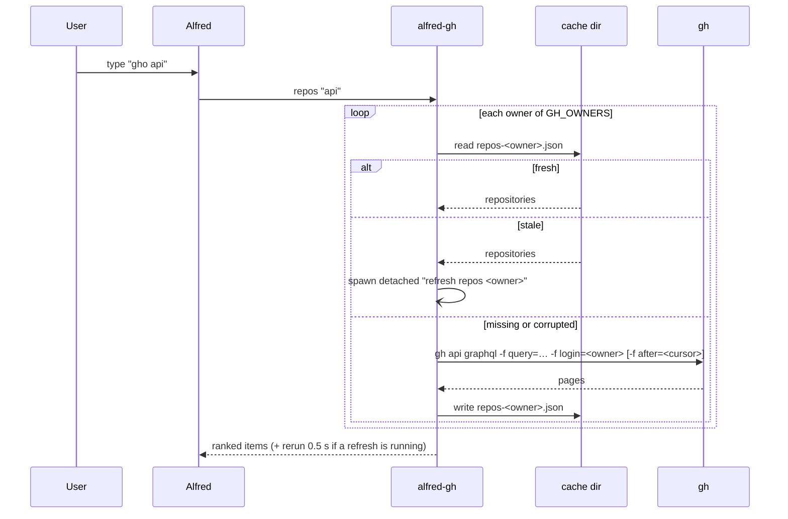

# Architecture

## Overview

The workflow is a single Rust binary, `alfred-gh`, with one subcommand per
object in the Alfred workflow graph:

| Subcommand                  | Alfred object                | Keyword | Responsibility |
| --------------------------- | ---------------------------- | ------- | -------------- |
| `alfred-gh repos [query]`   | Script Filter                | `gho`   | Repositories of `GH_OWNERS`, ranked. |
| `alfred-gh run <arg>`       | Run Script (`action.script`) | —       | Decode the selected item's `arg` and perform it. |
| `alfred-gh refresh <key>`   | — (spawned detached)         | —       | Rewrite one stale cache entry. |

Every script filter is connected to the single Run Script, itself connected to
a Post Notification that shows whatever `run` prints (copies, clones, errors).

## The `arg` protocol

Script filter items do not carry raw data: their `arg` — and the `arg` of each
modifier (`mods`) — is an encoded [`Action`](../src/action.rs):
`"<verb> <payload>"`. `run` decodes it with `Action::parse` and performs it
with `action::execute`.

| Verb         | Payload                 | Effect |
| ------------ | ----------------------- | ------ |
| `open`       | `<url>`                 | Open the URL with macOS `open`. |
| `copy`       | `<url>`                 | Copy the URL. |
| `clone-open` | `<owner/repo> <editor>` | `gh repo clone` into `~/Workspace/github.com/<owner>/<repo>` if missing (notifies), then `open -a <editor> <path>`. |
| `refresh`    | `all`                   | Clear every cache entry. |

Fields are ordered so that only the last one may contain spaces (application
names); URLs and `owner/repo` never do. `clone-open` only accepts a plain
`owner/repo` (no leading `-` or `.`, no extra `/`), so it can be neither a
flag for `gh` nor a path escape. A round-trip test covers every verb.

Each script filter declares connections for every modifier used
(<kbd>⌘</kbd>, <kbd>⌥</kbd>, <kbd>⌃</kbd>, <kbd>⇧⌘</kbd>), all to the same Run
Script, so a modifier's `arg` always reaches `run`.

## Talking to GitHub

- **`gh` only.** Authentication, token refresh and SAML SSO are `gh`'s job; no
  token is stored or logged. `gh` is resolved by absolute path
  (`/opt/homebrew/bin/gh`, then `/usr/local/bin/gh`) because Alfred does not
  load the shell `PATH`.
- **Fixed queries.** GraphQL queries are constants (`repos::REPOS_QUERY`);
  variables are passed as `-f name=value`, never interpolated, and never with
  `-F` (which would read a value starting with `@` as a file).
- **Owners of either kind.** `repositoryOwner(login:)` works for organizations
  and users (`organization(login:)` fails for users). `ownerAffiliations:
  [OWNER]` keeps a user's list to what they own: without it GitHub adds the
  repositories of every organization they collaborate with. The owner's kind
  (`__typename`) is cached with its repositories and later builds the
  `org:` / `user:` search qualifiers.
- **Errors.** A failed `gh` keeps stdout (`runner::CommandError`), where
  GraphQL errors are. `gh::Gh::classify` turns them into `GhError`: missing
  `gh` (install), not authenticated (`gh auth login`), rate limited (reset
  time from `gh api rate_limit`), SSO (`FORBIDDEN` / SAML errors), other.
  Each becomes an invalid item with the fix; the SSO item opens the token
  authorization page. One owner failing never hides the others; global
  errors (missing `gh`, not authenticated) are shown once.
- **SSO heuristic.** An organization returning no repository while another
  owner returns some is shown as "token not authorized for SSO", and is not
  cached.

## Cache

Entries are JSON files under `$alfred_workflow_cache`, one per `cache::Key`:

| Key            | File                 | TTL  |
| -------------- | -------------------- | ---- |
| `viewer`       | `viewer.json`        | 1 h  |
| `repos <owner>`| `repos-<owner>.json` | 1 h  |

Each file stores the value and its `fetched_at` Unix time; freshness is
computed against an injected clock, so the logic is unit-tested without
touching file times. A corrupted or mistyped file counts as missing. Writes go
through a temporary file and a rename.

A stale entry is served immediately; the script filter spawns
`alfred-gh refresh <key>` detached (all streams closed, so Alfred is not kept
waiting) and asks Alfred to rerun after 0.5 s. The refresh takes
`<key>.lock` (holding its start time); while a live lock exists no other
refresh is spawned. A successful refresh removes its lock; a failed one leaves
it until it expires (60 s), which is the back-off. The **Refresh cache** item
(`refresh all`) clears every entry.

## Design decisions

- **Everything is a pure function except one trait.** The only side-effecting
  boundary — spawning `gh`, `osascript` and `open` — is
  `runner::CommandRunner` (`SystemRunner` in prod, `FakeRunner` in tests). The
  cache directory is the only other state, tested with temporary folders.
- **Failures keep stdout.** `gh api graphql` prints GraphQL errors (`FORBIDDEN`,
  SAML enforcement, partial data) as JSON on stdout and exits 1. A failed
  `run` therefore returns a `CommandError { status, stdout, stderr }` rather
  than a plain message.
- **Background work is detached.** `CommandRunner::spawn_detached` starts a
  process with all three streams closed and returns at once: Alfred waits for
  a script filter's stdout to close, so an inherited stdout would block it.
- **No `uid` on items**: Alfred would re-sort by its own usage knowledge.
  Filtering and ordering happen in Rust (`alfredfiltersresults = false`).
- **Script filters never hard-fail**: errors become an invalid Alfred item.
- **Generic defaults**: owners and the Jira base URL come from Alfred's user
  configuration, never from code. Without `GH_OWNERS`, the authenticated
  user (`viewer { login }`) is the only owner.
